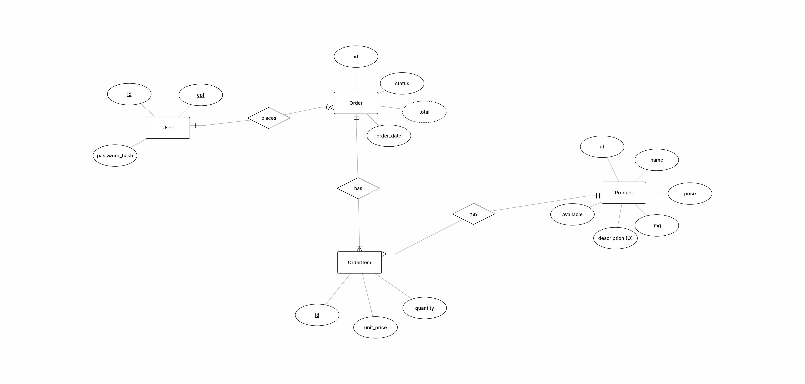
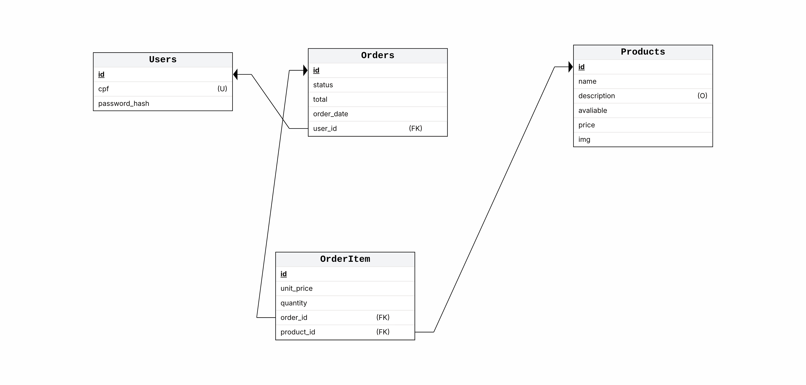

# Contexto

O projeto **Esquina Sabor** é um sistema web idealizado no programa Mais TI da Universidade Federal de Sergipe, com o intuito de consolidar os conhecimentos de desenvolvimento frontend e backend adquiridos na matéria de Desenvolvimento Web. Dessa forma, o esquina-sabor-api é uma API que intermedia as operações do usuário na pagina web com o acesso ao banco de dados da aplicação.

Por estar em um contexto de projeto educacional e com um tempo de implementação limitado, muitas decisões arquiteturais foram tomadas com o intuito de simplificar o escopo do projeto. Portanto, ao ler este documento, tenha em mente que essa API **não tem o intuito de ser um sistema projetado para uso real**.

# O domínio da aplicação

O Esquina Sabor é um restaurante fictício que deseja possuir um sistema web para que os clientes possam realizar pedidos através do navegador. Dessa forma, as principais entidades relacionadas à aplicação foram definidas como:

1. Usuários
2. Produtos
3. Pedidos

## Usuários

Os usuários são as pessoas que acessam a pagina web e realizam login na plataforma. 

Para simplificação de escopo, não haverá distinção real entre clientes e funcionários do restaurante, sendo todos os usuários considerados clientes e sem acesso a funcionalidades como cadastro de produto.

## Produtos

Os produtos são os itens vendidos no restaurante. Esses produtos são catalogados com informações padronizadas como nome, descrição opcional, preço e imagem do produto. 

Para simplificação de escopo, não haverá lógica para controle de estoque no sistema. O controle do estoque será feito através de um atributo que indica a disponibilidade do produto, havendo somente dois status possíveis, ```disponível``` e ```não disponível```.

## Pedidos

Os pedidos são a lista de itens que o usuário deseja comprar. Todo pedido obrigatóriamente precisa estar associado a um usuário e conter uma lista de produtos válidos.

Para simplificação de escopo, não será implementado um método de pagamento real. O pagamento será fictício, apenas mudando o estado do pedido para algo como ```pagamento efetuado```.

# O banco de dados da aplicação

A aplicação usará um banco de dados SQLite, com o arquivo ```database.sqlite``` armazenado dentro do diretório da API em ```data/```.

## Entidades e seus atributos

1. User -> tabela que armazena os usuários cadastrados na plataforma.
- id -> chave primária criado pelo banco de dados.
- cpf -> cpf do usuário.
- password_hash -> senha do usuário hasheada.

---

2. Product -> tabela que armazena os produtos do restaurante.
- id -> chave primária criado pelo banco de dados.
- name -> nome do produto.
- description -> descrição opcional do produto.
- price -> preço do produto.
- img -> imagem do produto.
- available -> estado de disponibilidade do produto.

---

3. Order -> tabela que armazena os pedidos dos usuários.
- id -> chave primária criado pelo banco de dados.
- user_id -> identificador que indica a qual usuário o pedido pertence.
- status -> estado do pedido.
- order_date -> data de criação do pedido.
- total -> valor total do pedido.

---

4. OrderItem -> tabela que armazena os itens de um pedido do usuário.
- id -> chave primária criado pelo banco de dados.
- order_id -> identifcador que indica a qual pedido o item pertence.
- product_id -> identificador que indica qual produto pertence a esse item.
- quantity -> quantidade do produto nesse item.
- unit_price -> preço unitário desse item.

## Diagramas

## Modelagem conceitual


---

## Modelagem lógica
(obs: o nome das tabelas foi padronizado para o singular, semelhante a como está na modelagem conceitual. Por favor, desconsidere os nomes desatualizados.)


# Metodologia e organização do desenvolvimento

Foi escolhida a metodologia ágil FDD (Feature-Driven Development) devido ao curto tempo hábil para o planejamento e a implementação do sistema. Dessa forma, o sistema será desenvolvido por meio da entrega contínua de pequenas funcionalidades que tenham valor para o cliente, sem a necessidade de criar documentações extensas antes de começar a implementar as funcionalidades.

Dado a escolha da metodologia, serão produzidos inicialmente duas documentações essenciais para o desenvolvimento do sistema:

- Modelo de domínio -> Representa os conceitos do negócio e seus relacionamentos. Esse documento é o conjunto deste arquivo (```architecture.md```) com os diagramas do banco de dados, sendo esse material suficiente para compreender o domínio da aplicação.

- Lista de funcionalidades -> Representa o inventário hierárquico das funcionalidades do sistema. Sendo organizado em **área de domínio**, **atividade de negócio** e **passos da atividade**. Sendo esse material necessário para compreender as funcionalidades que deverão ser implementadas no sistema.

---

A organização do desenvolvimento seguirá os princípios do Kanban, onde as funcionalidades estarão catalogadas como **backlog**, **ready**, **in progress** e **done**. 

Além disso, o quadro Kanban será gerenciado através do **Github Projects**, onde as Issues do repositório serão a representação de cada feature a ser implementada, possuindo título da implementação, descrição, regras de negócio, critérios de aceitação, labels e subtarefas técnicas descritas no corpo da Issue.

# Stack de desenvolvimento

Foi definido que o projeto fosse desenvolvido utilizando as ferramentas do ecossistema **Node.js**. Dessa forma, a stack escolhida foi:

- Framework -> Express.js
- ORM -> Prisma ORM
- Schemas e validações -> Zod
- Banco de dados -> SQLite local

# Estrutura de diretórios

A API será estruturada seguindo os princípios da organização **Folder By Feature**, da seguinte forma:

```
├── main.js
├── core/
│   ├── database.js
│   └── security.js 
├── prisma/
│   └── schema.prisma
├── domains/
│   ├── users/
│   │   ├── router.js
│   │   ├── service.js
│   │   └── schemas.js
│   ├── products/
│   │   ├── router.js
│   │   ├── service.js
│   │   └── schemas.js
│   └── orders/
│       ├── router.js
│       ├── service.js
│       └── schemas.js
└── data/
    └── database.sqlite
```


## Responsabilidades

### core

Responsável por armazenar os arquivos de configuração da API, como a conexão com o banco de dados e as funções de hashing de senha do usuário.

### prisma

Responsável por armazenar os modelos das tabelas do banco de dados.

### domains

Responsável por armazenar os domínios da aplicação.


Cada domínio possui os seguintes arquivos em comum:

- router -> definição das rotas do domínio.
- service -> camada de validação das regras de negócio e de acesso ao banco de dados (não haverá uma camada repository. Decisão feita para simplificação do escopo).
- schemas -> definição dos schemas do domínio, como dados de entrada, saída, etc.

### domains/users

Referente aos usuários da aplicação.

### domains/products

Referente aos produtos do restaurante.

### domains/orders

Referente aos pedidos dos usuários.

### data

Responsável por armazenar o arquivo sqlite.


